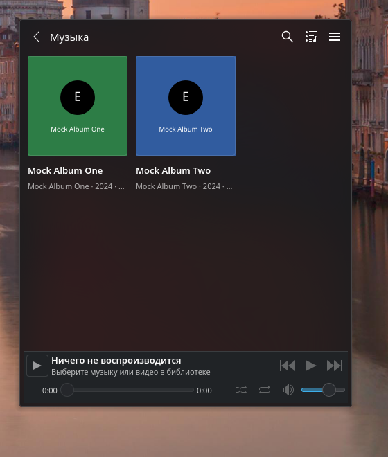
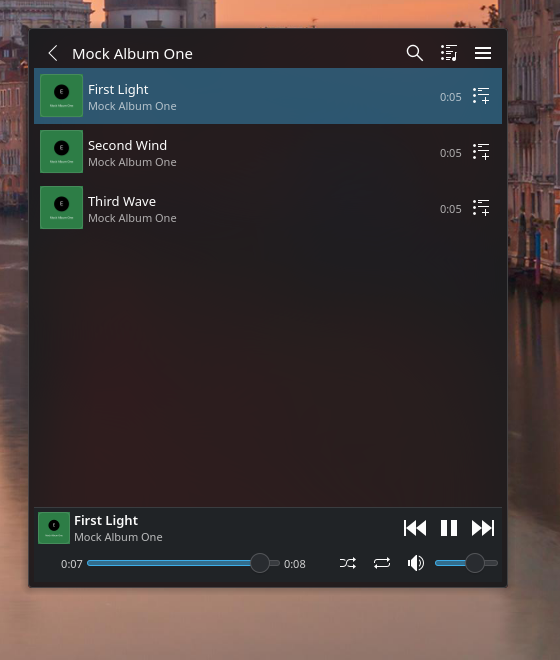
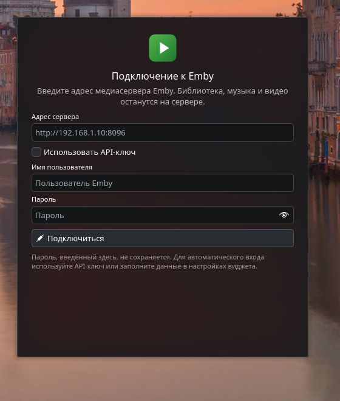
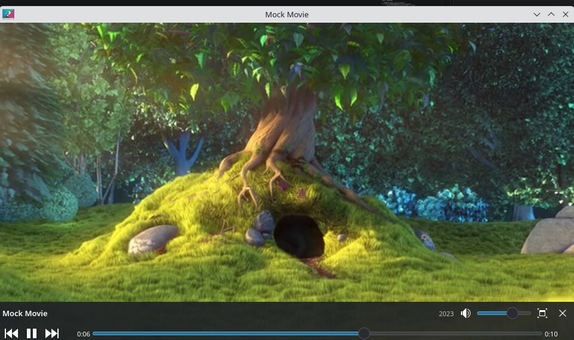

# Emby Media для KDE Plasma 6 (Debian 13 trixie)

> Неофициальный клиент Emby. Проект не связан с Emby LLC и не поддерживается ею.

Виджет Plasma 6, который подключается к медиасерверу Emby напрямую, показывает
библиотеку, играет музыку и видео, управляет очередью и отображает обложки
альбомов. Никакого отдельного демона или Python-пакета не требуется: запросы к
Emby выполняются из QML, воспроизведение — через Qt Multimedia.




## Возможности

- подключение по API-ключу Emby или по логину и паролю;
- автоматический вход по сохранённому токену;
- навигация по библиотекам: фильмы, сериалы → сезоны → серии, музыка →
  папки/альбомы/исполнители → треки, плейлисты, папки, коллекции;
- поиск по всей библиотеке;
- проигрывание музыки с очередью, перемоткой, громкостью, повтором и
  перемешиванием;
- перемешивание всего каталога/папки/альбома целиком (рекурсивно), а не только
  видимого списка;
- видео по умолчанию воспроизводится внутри виджета; кнопка открывает его
  в отдельном окне поверх остальных (в том числе под Wayland);
- звук выводится на устройство, выбранное по умолчанию в системе
  (Plasma/PipeWire/PulseAudio);
- обложки альбомов и постеры в списках, карточках и плеере;
- компактное представление в панели/на рабочем столе: обложка, название трека,
  прогресс, пауза по средней кнопке мыши, громкость колесом;
- отправка прогресса просмотра/прослушивания на сервер Emby.

## Требования

- Debian 13 (trixie) с KDE Plasma 6.3 или новее;
- `kpackagetool6` — отдельный пакет `kpackagetool6` (в Debian/Ubuntu);
- модуль QML `qml6-module-qtmultimedia` и библиотека `libqt6multimedia6`
  (обычно уже установлены вместе с Plasma);
- QML-модули `qml6-module-org-kde-kwindowsystem` и
  `qml6-module-org-kde-plasma-plasma5support` (нужны для окна «поверх всех»
  на Wayland);
- декодеры FFmpeg из состава Debian. Для дополнительных кодеков можно
  установить `libavcodec-extra`, если он доступен в репозитории.

Проверить наличие зависимостей:

```bash
sudo apt install plasma-workspace kpackagetool6 qml6-module-qtmultimedia \
    libqt6multimedia6 qml6-module-org-kde-kwindowsystem \
    qml6-module-org-kde-plasma-plasma5support
```

Для разработки дополнительно нужен `qt6-declarative-dev-tools` (содержит
`qmllint`).

## Установка

```bash
git clone <адрес-репозитория> emby-plasma
cd emby-plasma
./install.sh
```

Или без скрипта:

```bash
kpackagetool6 --type Plasma/Applet --install package
```

После установки перезапустите Plasma:

```bash
systemctl --user restart plasma-plasmashell.service
```

Затем щёлкните правой кнопкой по панели или рабочему столу → «Добавить
виджеты» → **Emby**. На рабочем столе виджет сразу показывает библиотеку;
в панели он отображается компактно, а по нажатию открывается полное окно.

Обновление после изменения исходников:

```bash
./install.sh
systemctl --user restart plasma-plasmashell.service
```

Удаление:

```bash
./uninstall.sh
```

## Настройка подключения



1. Откройте панель управления Emby → **API Keys** и создайте ключ.
   Это рекомендуемый способ: ключ не зависит от пароля и переживает смену
   пароля пользователя.
2. Откройте виджет, введите адрес сервера, например
   `http://192.168.1.10:8096`, отметьте «Использовать API-ключ» и вставьте ключ.
3. Нажмите «Подключиться». Токен и идентификатор устройства сохранятся, при
   следующем запуске вход произойдёт автоматически.

Вход по логину и паролю тоже поддерживается. Пароль, введённый непосредственно
в виджете, **не сохраняется** — сохраняется только полученный токен. Поля
«Пользователь» и «Пароль» в настройках виджета предназначены для автоматического
повторного входа и хранятся в конфигурации KDE в открытом виде; для постоянного
доступа лучше использовать API-ключ.

Поддерживаются адреса:

- `http://host:8096` — виджет сам добавит `/emby`;
- `http://host:8096/emby` — путь уже указан;
- `https://emby.example.com` — при необходимости с обратным прокси;
- `https://emby.example.com/custom-prefix` — произвольный префикс сохраняется.

Самоподписанный HTTPS-сертификат нужно добавить в системное хранилище доверия
Debian: Qt не игнорирует ошибки проверки TLS.

### Если Emby доступен только через прокси/VPN

`plasmashell` запускается systemd и не наследует переменные прокси из
интерактивной оболочки. Qt (API и обложки) и Qt Multimedia/FFmpeg (потоки)
читают `http_proxy`/`https_proxy`, поэтому для локального HTTP-прокси (например,
Xray/Happ на `127.0.0.1:10808`) нужно добавить drop-in для пользовательского
сервиса:

```bash
./setup-plasmashell-proxy.sh http://127.0.0.1:10808
```

Скрипт создаёт
`~/.config/systemd/user/plasma-plasmashell.service.d/proxy.conf` и перезапускает
plasmashell. Удалить настройку:

```bash
./setup-plasmashell-proxy.sh --remove
```

Без этого Emby будет виден только если сервер доступен напрямую по обычному
маршруту.

## Использование

### Музыка

- Нажмите на библиотеку «Музыка», затем на альбом или исполнителя.
- Нажмите на трек — начнётся воспроизведение, очередь заполнится треками
  текущего списка.
- Кнопка добавления в очередь справа от трека добавляет его в очередь.
- Верхние кнопки открывают поиск, очередь и меню.
- Внизу: обложка, название, исполнитель/альбом, перемотка, пауза,
  предыдущий/следующий трек, повтор, перемешивание, громкость.

### Перемешать весь каталог

1. Откройте библиотеку, папку, исполнителя или альбом.
2. Нажмите кнопку с иконкой перемешивания в заголовке (или меню →
   **«Перемешать весь каталог»**).
3. Виджет рекурсивно загрузит все вложенные треки/видео, перемешает их и
   поставит в очередь; воспроизведение начнётся с первого элемента.

Это одноразовое перемешивание: элементы очереди идут в случайном порядке,
поэтому динамическое перемешивание в плеере выключается. Переключатель в плеере
(рядом с повтором) включает другой режим — случайный выбор следующего трека.

### Видео

- Нажмите на фильм или серию — видео откроется внутри виджета.
- Кнопка с иконкой окна на панели управления видео открывает его в отдельном
  окне, которое удерживается поверх других окон (на Wayland для этого
  используется небольшой KWin-скрипт из `contents/code/keep-above.js`).
- Двойной клик по видео внутри виджета также открывает отдельное окно.
- В отдельном окне: пробел — пауза, ←/→ — ±10 секунд, ↑/↓ — громкость,
  `M` — звук, `F` или двойной клик — полный экран, `Esc` — выйти из полного
  экрана или вернуть видео в виджет.
- Кнопка «Вернуть в виджет» закрывает отдельное окно и снова показывает видео
  внутри виджета.



*На снимках — тестовая библиотека. Кадр в окне видео: Big Buck Bunny,
Blender Foundation, CC BY 3.0.*

### Панель и рабочий стол

- На рабочем столе отображается сразу вся библиотека и плеер.
- В панели виджет компактен: левая кнопка открывает/закрывает полное окно,
  средняя — пауза/воспроизведение, колесо мыши — громкость.
- Во время воспроизведения на компактном представлении видны обложка,
  прогресс и название.
- Библиотека импортируется в том виде, в котором она лежит на сервере:
  музыкальные папки, папки клипов и смешанные папки показываются как папки,
  без искусственного переименования или фильтрации по типу.

## Ограничения

- Используется **Direct Play / Direct Stream**. Сервер не перекодирует поток.
  Если кодек не поддерживается локальным FFmpeg, появится ошибка
  воспроизведения; в этом случае установите дополнительные кодеки или
  используйте клиент Emby с транскодированием.
- Нет выбора аудиодорожки и субтитров.
- Нет офлайн-загрузки и синхронизации.
- Фотографии и книги в библиотеке не отображаются: виджет рассчитан на музыку
  и видео.
- Прогресс отправляется периодически (каждые 10 секунд), а также при паузе,
  смене трека и остановке. Отметка «просмотрено» зависит от настроек Emby.
- Воспроизведение начинается с начала элемента; функция «продолжить с места»
  пока не реализована.
- Токен, API-ключ и (если заполнен) пароль хранятся в конфигурации KDE в
  открытом виде. Ограничьте доступ к `~/.config/plasma-org.kde.plasma.desktop-appletsrc`
  и используйте отдельный API-ключ для виджета.

## Устройство проекта

```
install.sh                         установка/обновление виджета
uninstall.sh                       удаление виджета
setup-plasmashell-proxy.sh         настройка прокси для plasmashell (необязательно)
scripts/check.sh                   проверка QML и структуры пакета
package/
├── metadata.json                 метаданные Plasma-виджета
└── contents/
    ├── code/
    │   └── keep-above.js          KWin-помощник «поверх всех окон» на Wayland
    ├── config/
    │   ├── main.xml              схема конфигурации
    │   └── config.qml            модель страниц настроек
    ├── icons/emby.svg
    └── ui/
        ├── main.qml              PlasmoidItem, конфигурация, видео-окно
        ├── Representation.qml    выбор полного/компактного представления
        ├── EmbyClient.qml        REST-клиент Emby (XMLHttpRequest)
        ├── PlaybackController.qml очередь, Qt Multimedia, системный аудиовыход
        ├── FullRepresentation.qml библиотека, поиск, очередь, плеер
        ├── CompactRepresentation.qml панель/рабочий стол
        ├── LoginView.qml         вход в Emby
        ├── PlayerBar.qml         панель управления воспроизведением
        ├── QueueView.qml         очередь
        ├── EmbeddedVideo.qml     видео внутри виджета
        ├── VideoWindow.qml       отдельное окно видео
        ├── MediaRow.qml          строка списка элементов
        ├── SeekSlider.qml        перемотка, привязанная к плееру
        ├── VolumeSlider.qml      громкость, привязанная к плееру
        ├── ToolTipButton.qml     кнопка с подсказкой Plasma
        ├── AlbumArt.qml          обложка с заглушкой
        ├── Formatting.js         форматирование длительности и подписей
        └── configGeneral.qml     страница настроек
```

## Разработка и проверка

Перед коммитом запустите:

```bash
sudo apt install qt6-declarative-dev-tools
./scripts/check.sh
```

Скрипт проверяет синтаксис QML (`qmllint --bare`) и структуру KPackage
(`kpackagetool6`). Полный `qmllint` без `--bare` в обычной оболочке будет
предупреждать об импортах `org.kde.plasma.*`: эти модули регистрирует
plasmashell во время работы.

Проверка структуры пакета вручную:

```bash
mkdir -p /tmp/plasmoid-test
kpackagetool6 --type Plasma/Applet --packageroot /tmp/plasmoid-test \
    --install package
```

Логи plasmashell при отладке:

```bash
journalctl --user -u plasma-plasmashell.service -f
```

Правила оформления кода и pull request описаны в
[CONTRIBUTING.md](CONTRIBUTING.md).

## История изменений

См. [CHANGELOG.md](CHANGELOG.md).

## Лицензия

GPL-3.0-or-later. См. [LICENSE](LICENSE).
